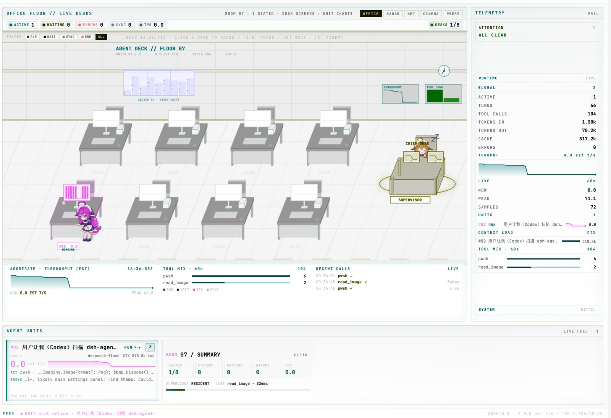
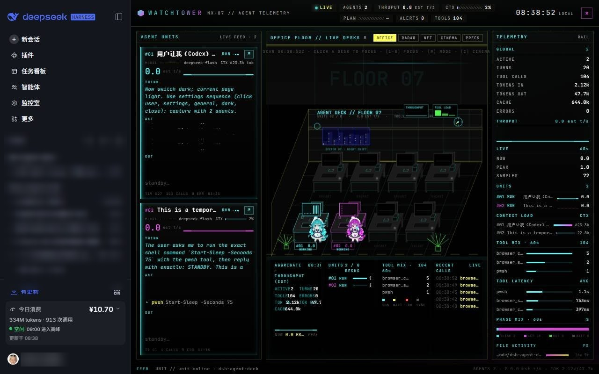

# dsh-agent-deck

English · [中文](README.md)

## Screenshots





## About

Agent Deck is a read-only multi-agent telemetry console for the DSH Web GUI. It turns each running session into an office desk and a whale-girl, showing live status, thinking, tool calls, output, context usage and throughput, with OFFICE / RADAR / NET stages and a single-agent ANALYZE view. It only reads Host session telemetry and never writes back to a session.

## Usage

1. Open the DSH Web GUI and choose **Control Room** in the left sidebar.
2. `OFFICE` is the default stage; use `RADAR / NET` to switch views.
3. Click a TUI card or an office desk to focus an agent; press `Esc` or click `× RELEASE` to return.
4. Click `↗` on a card to open that session.
5. Press `C` or click `CINEMA` for the full-width stage; `Esc` exits.
6. `PREFS` controls visits, visit pace, max visitors and desk actions; preferences are stored in the current browser.

The panel follows DSH's light/dark theme. When no session is active, a resident whale-girl stays in the left panel and at desk `#00` so the room does not look empty.

## Installation

Requires a DSH installation with plugin support (Web GUI).

```bash
dsh plugin --profile <profile> add <absolute-repo-path>
```

Examples:

```bash
# Windows
dsh plugin --profile desktop add D:\code\dsh-agent-deck

# macOS / Linux
dsh plugin --profile desktop add /path/to/dsh-agent-deck
```

No `npm install` or build step is needed; refresh the DSH Web GUI after installing.

### Let an agent install it

> Install https://github.com/windsor8890/dsh-agent-deck with `dsh plugin --profile <profile> add <absolute-repo-path>`, then refresh the DSH Web GUI.
