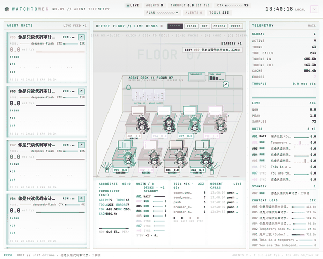
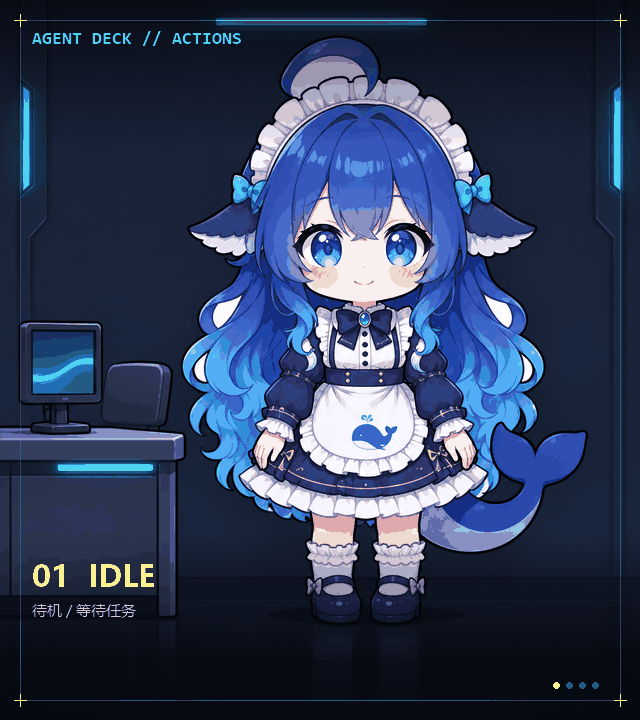

# dsh-agent-deck

**简体中文** | [English](README.en.md)

## 截图




## 鲸鱼娘形象

DIY 鲸鱼娘形象，共 7 个状态姿势。下面是由逐帧 PNG 合成的动作循环（待机 / 工作 / 摸鱼 / 游戏）：



| 状态 | 形象 | 说明 |
|---|---|---|
| `front` |  | 默认 / 交谈 |
| `happy` |  | 空闲闭眼 / 保留期 |
| `stand` |  | 工作中（举手） |
| `side` |  | 走路 / 串访 |
| `slack` |  | 摸鱼 / 等待人工（手机） |
| `game` |  | 空闲等待（手柄） |
| `rest` |  | 出错 / 背对 |

## 简介

Agent Deck 是 DSH Web GUI 的只读多智能体监控面板：把每个正在运行的会话画成办公室工位和鲸鱼娘，实时汇总状态、思考、工具调用、输出、上下文与吞吐，并提供 OFFICE / RADAR / NET 三种舞台和单 agent 的 ANALYZE 解剖视图。它只读取 Host 的会话遥测，不向会话写回任何内容。

## 使用方法

1. 打开 DSH Web GUI，在左侧选择「监控室」。
2. 舞台默认是 `OFFICE`；舞台顶部可切换 `RADAR / NET`。
3. 单击底部 `AGENT UNITS` 卡片或办公室工位聚焦该 agent；`× RELEASE` 或 `Esc` 返回。
4. 点卡片右上 `↗` 打开对应会话。
5. `C` 或 `CINEMA` 进入铺满舞台的布局；`Esc` 退出。
6. `PREFS` 可调访客开关、串访节奏、最多访客数、桌面动作开关和 `CINEMA SKIN`（`COZY` / `COLD`），偏好仅保存在当前浏览器。
7. 舞台顶部战况条显示 `ACTIVE / WAITING / ERRORS / SYNC / TPS / DESKS`；点 `FILTER` 图例可按状态高亮。
8. 悬停工位或卡片会高亮同会话/同族 agent；9+ 活跃时会显示横向 agent 状态条。

面板跟随 DSH 的浅色/深色主题；没有活跃会话时，办公室和底部 filmstrip 会保留一位值班鲸鱼娘，避免空场。

## 安装

要求：已安装带插件能力的 DSH（使用 Web GUI）。

```bash
dsh plugin --profile <profile> add <本仓库绝对路径>
```

例如：

```bash
# Windows
dsh plugin --profile desktop add D:\code\dsh-agent-deck

# macOS / Linux
dsh plugin --profile desktop add /path/to/dsh-agent-deck
```

无需 `npm install` 或构建步骤；安装后刷新 Web GUI 即生效。

### 让 agent 自行安装

> 请把 https://github.com/windsor8890/dsh-agent-deck 用 `dsh plugin --profile <profile> add <仓库绝对路径>` 安装到当前 DSH profile，然后刷新 Web GUI。

代码采用 [MIT](LICENSE)；角色与截图素材许可见 [ASSETS.md](ASSETS.md)。
