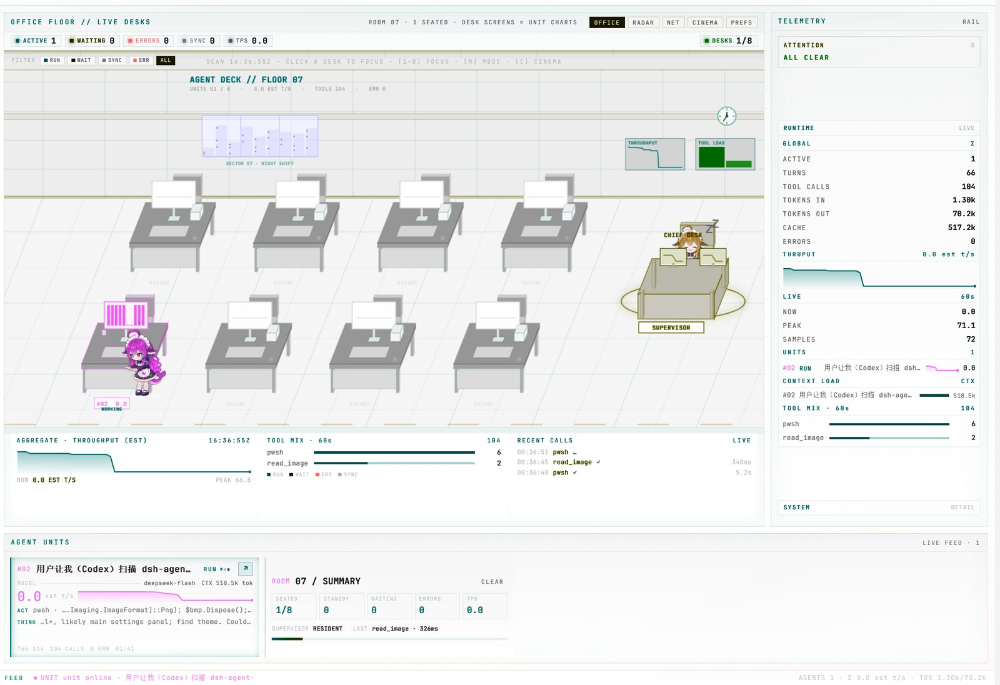
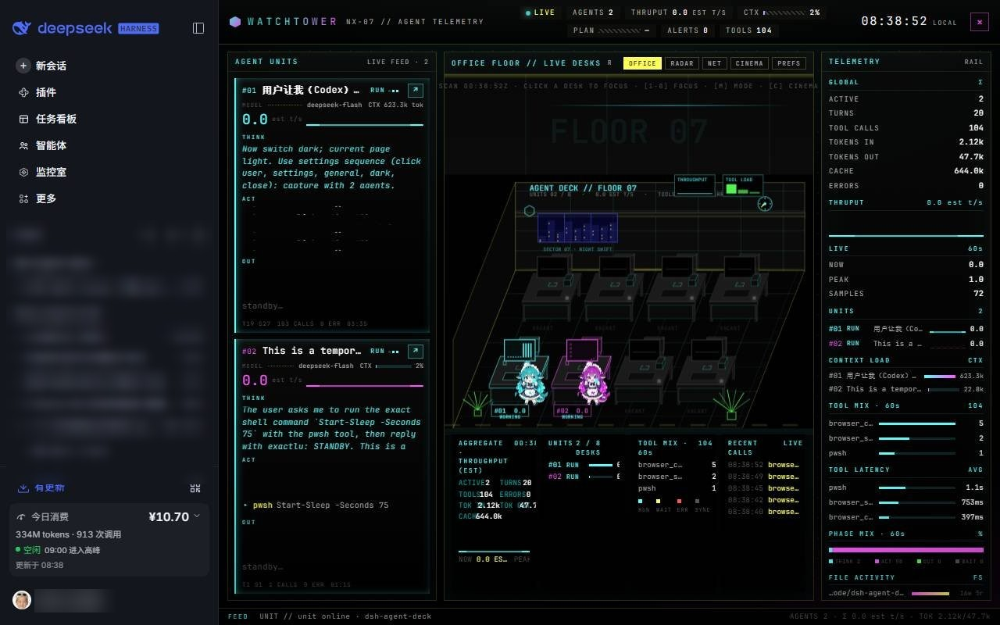

# dsh-agent-deck

Agent Deck 是 DSH Web GUI 的只读多智能体监控面板：把每个正在运行的会话画成办公室工位和鲸鱼娘，实时汇总状态、思考、工具调用、输出、上下文与吞吐，并提供 OFFICE / RADAR / NET 三种舞台和单 agent 的 ANALYZE 解剖视图。它只读取 Host 的会话遥测，不向会话写回任何内容。

## 截图

### 浅色模式



### 深色模式



## 使用方法

1. 打开 DSH Web GUI，在左侧选择「监控室」。
2. 舞台默认是 `OFFICE`；底部 `RADAR / NET` 切换视图。
3. 单击左侧 TUI 卡或办公室工位聚焦该 agent；`× RELEASE` 或 `Esc` 返回。
4. 点卡片右上 `↗` 打开对应会话。
5. `C` 或 `CINEMA` 进入铺满舞台的布局；`Esc` 退出。
6. `PREFS` 可调访客开关、串访节奏、最多访客数和桌面动作开关，偏好仅保存在当前浏览器。

面板跟随 DSH 的浅色/深色主题；没有活跃会话时，办公室和左栏会保留一位值班鲸鱼娘，避免空场。

## 安装

要求：已安装带插件能力的 DSH（使用 Web GUI）。

### DSH CLI

```bash
dsh plugin --profile <profile> add <本仓库绝对路径>
```

例如：

```bash
# Windows
dsh plugin --profile desktop add D:\code\dsh-agent-deck

# macOS / Linux
dsh plugin --profile desktop add /path/to/dsh-agent-deck
```

无需 `npm install` 或构建步骤；安装后刷新 Web GUI 即生效。

### 让 agent 自行安装

把下面这段提示词发给任意能在本机执行命令的 agent：

```text
请在本机安装 DSH Agent Deck 插件。

1. 如果本机还没有仓库，先克隆：
   git clone https://github.com/windsor8890/dsh-agent-deck.git
   如果已有本地目录，直接使用该绝对路径。
2. 用仓库绝对路径安装到当前 DSH profile：
   dsh plugin --profile <profile> add <仓库绝对路径>
   - 不知道 profile 时先确认当前使用的 profile（通常是 desktop）。
   - 如果 dsh 不在 PATH，改用 DSH 安装目录下的 CLI，例如：
     Windows: "D:\Program Files\dsh\resources\runtime\cli\bin\dsh.cmd"
3. 刷新 DSH Web GUI，在左侧打开「监控室」，确认 Agent Deck 面板出现。

不要修改仓库源码；完成后报告使用的 profile、安装路径和验证结果。
```
