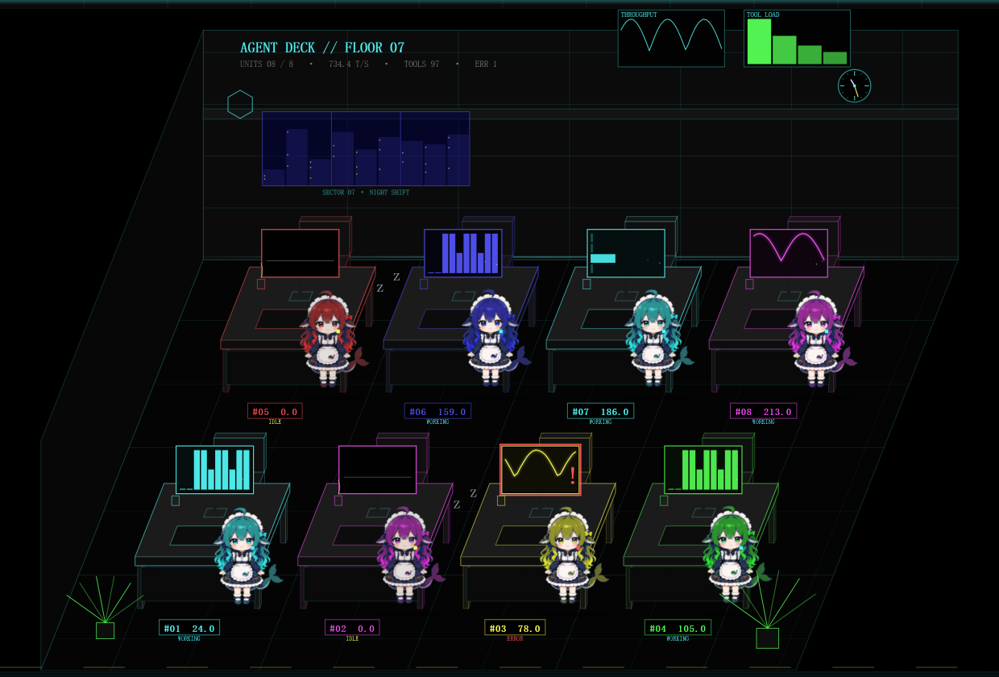
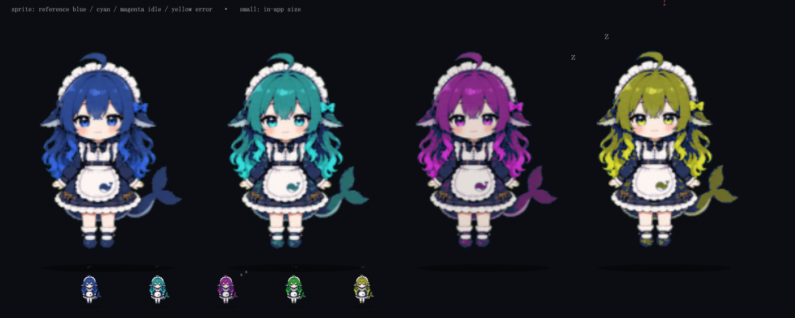
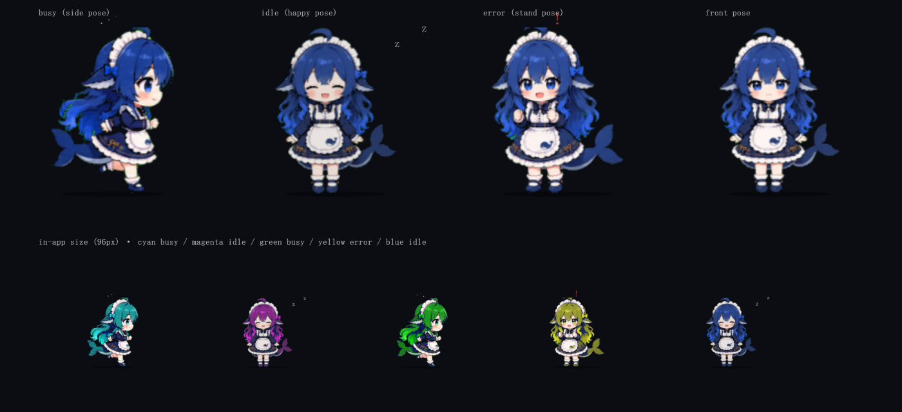
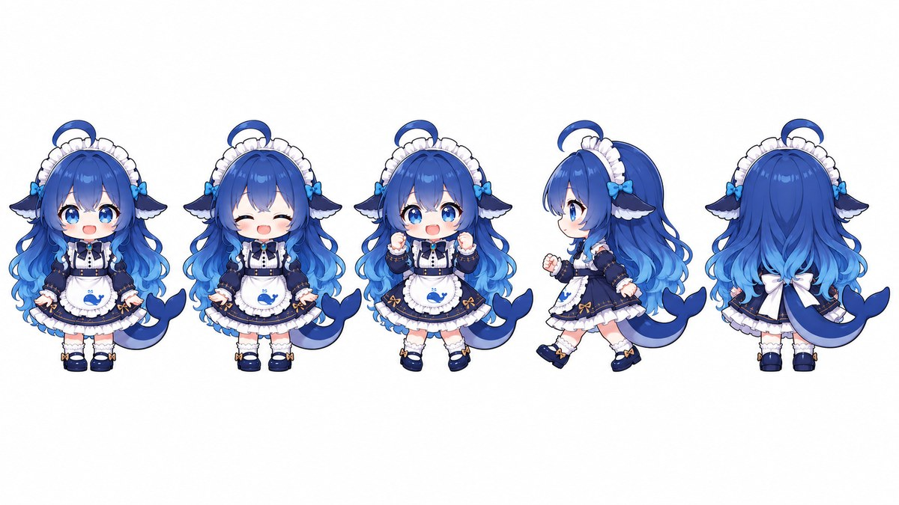
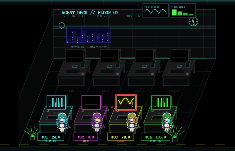

# Agent Deck · 监控室

赛博朋克 HUD 风格的智能体监控台：把当前 Host 里**每一个正在工作的智能体**渲染成一台
流式 TUI 监视窗（思考 / 执行 / 输出），中间主舞台用真实遥测驱动数据可视化，并支持
「群体视图 ⇄ 个体解剖」双模式。

只读插件：不写会话日志、不改任何会话状态、不消费用户输入。

## 入口

| 入口 | 座位 | 说明 |
|---|---|---|
| 侧边栏「监控室」 | `sidebar.panellist` + `main` | 标准 Harness 外壳，打开后独占中央面板 |
| 右上角 NX-07 浮动钮 | `shell.overlay` | 替换了侧边栏的自定义外壳下的兜底入口；面板已打开时自动隐藏 |

面板内右上的 `×` 回到会话。

## 截图（含历史版本，配色与布局可能不同）











## 舞台视图

**OFFICE（默认）** —— **浅等距 2.5D**办公场景（行是横向的，纵深朝后上方收；桌面/显示器/椅子/键盘都是
斜投影实体块，不是 45° 旋转的等距棋盘），铺在舞台上方：两排 × 四列共 **8 张工位**，正好等于最大同时显示
单元数（`MAX_CARDS = 8`）；每个 Session 首次出现时分配**固定工位**（前排左起 1–4、后排 5–8），超过 8 个单元时
未分到工位的进入舞台右上角 `STANDBY +N` 托盘（可点击聚焦）；空位保留为暗色工位。墙面有 `WATCHTOWER // FLOOR 07`
招牌、夜景窗、走字钟、两块壁挂数据板；地面带纵深网格、黄色导引线、前景绿植。每张工位上的东西全部是真实遥测：

| 工位元素 | 真实数据 |
|---|---|
| 显示器里的迷你图 | 该单元自己的吞吐采样 / 工具调用分桶 / 最近调用耗时（三种轮换） |
| 屏幕读数 | 该单元缓动的**估算** tokens/s（EST） |
| **站在桌边的鲸鱼娘** | 五张生成精灵内嵌（`assets/whale-girl-{front,happy,stand,side,rest}.png`，由本地 Codex imagegen 依据授权设定图 + 资源库 Q 版 prompt 生成；front=默认、happy=闭眼空闲、stand=举手忙碌、side=走路、rest=背面出错），每个 agent 用身份色对发色/尾鳍选择性换色；空位不出现 |
| 鲸鱼娘 · 忙碌 | 用「举手」参考图、轻微起伏、头顶冒小火花、屏幕亮 |
| 鲸鱼娘 · 空闲 | 用「闭眼开心」参考图、半透明、`z z` 上浮、身体轻微摇晃、屏幕只剩扫描线 |
| 鲸鱼娘 · 出错 | 用「背面」生成姿势、头顶红色 `!` 闪烁、屏幕红框闪烁 |
| 桌面板名牌 | `#01 96.5` + `WORKING / IDLE / ERROR` |
| 桌角状态灯 | RUN 青 / WAIT 黄 / ERR 红 / SYNC 灰 |
| 鲸鱼娘 · 走动 | 用「侧身」参考图，在工位间串访时脚步弹跳、方向自动镜像，身后带扬尘 |
| 鲸鱼娘 · 交谈 | 到达同事桌边后面向对方、轻微点头；头顶气泡轮播 `… / ? / ! / ♪`，父子 agent 显示 `DELEGATE` |

**鲸鱼娘会动**：待机呼吸、工作时轻微起伏、出错抖动、串访时用侧面姿态在工位间走动；到达后发出 `CHATTING` / `VISITING` 桌牌，聊一会儿再走回自己的工位。来自委派拓扑的父子 agent 优先串访（气泡显示 `DELEGATE`），普通同事之间随机串访。**同时最多可有三位访客**（按在场座位数自适应，访客与目标不会重复占用同一单元），`prefers-reduced-motion` 下关闭串访与额外动效。
**点任意工位即可聚焦**（等于点 TUI 卡）。舞台最下方是**横排的四块读数面板**：
AGGREGATE·THROUGHPUT（含吞吐曲线，标 `EST`）、UNITS（`n / 8 DESKS`，溢出时 `+N STANDBY`）、TOOL MIX·60s、RECENT CALLS。
原来那条独立图表带已并入 AGGREGATE 面板。

**RADAR** —— 聚合反应堆视图（`M` 循环切换）：缓动的全局估算 tokens/s、随吞吐呼吸的核心、
按吞吐占比切分的环形弧（弧上标身份 tag 与速率）、外环身份色轨道节点；极坐标网格预渲染为静态图层。

**NET** —— 多智能体拓扑星座：`HOST` 核心 + 委派血缘边，边上跑消息粒子（速度随吞吐），
连线中点带 `delegate` / `session` 消息胶囊（子节点身份色）；节点大小/光晕随吞吐与状态变化，
闲置祖先灰显。点击节点直接聚焦。

**ANALYZE（点 TUI 卡或按数字键聚焦）** —— 个体解剖六宫格，左右栏自动收起让出整幅宽度；舞台右上角的 `× RELEASE` 或 `Esc` 返回。

| 宫格 | 内容 | 真实数据来源 |
|---|---|---|
| CONTEXT PRESSURE | 上下文占用环 + CACHE/OUTPUT/REASON 分解 | `usage` 帧与 `assistant/message` 的 `TokenUsage`、`request/context.contextWindow` |
| TASK PROGRESS | todo 完成度环 + 前 3 条任务 | `todo_write` 工具调用参数里的 `todos` |
| TOOL MATRIX | 工具名 × 12 个时间桶（60s）热力矩阵 | `tool/call` + `tool/result` 时间戳 |
| PHASE TIMELINE | THINK / ACT / OUT 三泳道 60s 甘特 | 流帧类型（reasoning-delta / tool-call-delta / text-delta）的相位变化 |
| FILE HEAT | 被读写最多的文件条形图（w/r 计数） | 文件类工具调用的 `path` 参数 |
| THRUPUT TRACE | 个体估算 tokens/s 曲线（72 采样） | 近 3s 字符增量估算（含思考+正文） |

## 空闲保留

Session 停止运行后，工位保留 **3 分钟**：单元继续坐在**原工位**显示空闲姿势，保留期内不因活跃度变化而换座；
保留期满或会话删除才释放工位，并把空出的席位按「运行优先、先等待先得」交给溢出队列。超过 8 个单元时，
未分到工位的单元在舞台右上角 **`STANDBY +N` 托盘**列出（可点击聚焦），TUI 墙仍另有 `LIVE FEED +N`。
左侧 LIVE FEED 仍只列正在运行的 agent，“只看工作中”的规则不变。

## 右栏遥测（13 块常驻，全部真实数据；另有 STANDBY/ALERTS 条件块）

GLOBAL 汇总（含 TOKENS IN / OUT / CACHE）、THRUPUT（全局吞吐折线 + NOW/PEAK/SAMPLES，标 `est t/s`）、
UNITS（状态 + 每单元不同的迷你图：折线/柱状/队列轮换）、STANDBY（仅溢出时出现）、CONTEXT LOAD、
TOOL MIX·60s、TOOL LATENCY（平均耗时排行）、PHASE MIX·60s（THINK/ACT/OUT/WAIT 占比堆叠条）、
FILE ACTIVITY（跨单元合并）、MODELS、`agent-deck.ini`（监控器自己的真实参数，代码面板样式）、
ALERTS、EVENT LOG、SYSTEM（运行时长/数据窗口/节拍）。
底部另有一条事件 ticker。栏内可滚动。顶栏有三条进度：聚合 CTX 预算条、PLAN（所有单元的
todo 完成度合计）、以及缓动的 THRUPUT 读数。

## TUI 卡

- **THINK** — 模型 reasoning 流（`reasoning-delta`），无思考通道时明确降级
- **ACT** — 工具调用：名称、关键参数、状态（▸ 运行中 / ✓ 完成 / ! 失败）、耗时
- **OUT** — 助手输出文本流（`text-delta`，最终以 `assistant/message` 覆盖去重）
- 元信息：模型、上下文 token、**估算** tokens/s（UI 标 `est t/s`）、回合/步、调用数、失败数、时长
- **身份色**：每个单元从 IBM 5153 分到固定强调色（轮转），用于卡号、拓扑节点、舞台 UNITS 行、
  右栏 UNITS 行——多单元时一眼区分；状态色（RUN/WAIT/ERR/SYNC）仍独立编码
- **指标条**：大号 tokens/s + 迷你 sparkline（自身 72 采样）+ 与前 30s 的涨跌箭头；RUN 时带跳动 live 点
- 状态色：RUN 青 / WAIT 琥珀（空闲或等待人工）/ ERR 品红呼吸 / SYNC 灰
- **高度自适应**：只有一个单元时卡片铺满整列（THINK/ACT/OUT 三段等比分配剩余高度，文本贴底显示最新内容）；
  多个单元时均分；超过约 4 个后每张保持最小高度并整列滚动

## 交互

**“放大”是布局上的聚焦 / CINEMA，不是浏览器全屏**（没有调用 Fullscreen API）：聚焦会进入 ANALYZE 视图并收起左右栏，CINEMA 只收左右栏、保留画布。

| 操作 | 效果 |
|---|---|
| 点卡片右上 `↗` | 打开对应会话 |
| 点 TUI 卡 | 聚焦该智能体（进入 ANALYZE，右上出现 `× RELEASE`）；`× RELEASE` / `Esc` 退出聚焦 |
| **点办公室工位** | 聚焦该智能体（进入 ANALYZE）；用 `× RELEASE` / `Esc` 返回 |
| 点 NET 节点 | 聚焦该智能体 |
| `1`–`8` | 聚焦对应工位（前排左起 1–4，后排 5–8） |
| `Esc` | 退出聚焦；再按退出 CINEMA |
| `C` | CINEMA 布局：隐藏左右栏，舞台铺满；`Esc` 退出 |
| `M` | 循环切换 OFFICE → RADAR → NET |
| 右上 `×` | 回对话 |

## 数据来源（全部只读）

| 数据 | 来源 |
|---|---|
| 有哪些会话 / 谁在运行 | `ctx.sessions.list`（`byId[].running`），`phase` 为 `pending\|ready` |
| 单个会话的实时事件窗 | `ctx.sessions.retain(id, {source:'watchtower'})` → `reference.ready` → `binding.eventSource` |
| 思考 / 输出 / 工具流 | 瞬时帧 `assistant/live-chunk` 的 `StreamChunk` |
| 回合、步、工具结果、usage | 持久事件 `turn/start`、`step/start`、`tool/call`、`tool/result`、`assistant/message` |
| 模型 / 上下文窗口 | `request/header`、`request/context`、`assistant/message.source.model` |
| 拓扑血缘 | 会话列表行的 `parentId` / `origin` |
| 等待人工 | `ctx.uiSession.sessionStatus`（`pendingInteraction`） |
| 主题色 | `ctx.theme.getTheme()` 的 `active.colorScheme`，`theme/change` 事件实时跟随 Host 外观设置 |
| 吞吐（估算） | 最近 3s 的 `reasoning-delta` + `text-delta` UTF-16 字符数 / 3 / 3.5 ≈ tok/s；不含工具参数，不是模型的 token 计数（UI 标 `EST`） |
| token 用量（精确） | `assistant/message` 的 `TokenUsage`：TOK IN（不含 cache）/ TOK OUT / CACHE（cache read + write）分开呈现；`usage` 流帧仅在同一次尝试内覆盖 |
| 工位与溢出 | Session id → 固定 desk slot；满 8 席后进入 STANDBY 托盘，席位释放按运行优先、先等待先得重分配 |

事件窗的 `change.kind` 为 `append | prepend | replace | settle-assistant`
（`settle-assistant` 不带 entries，瞬时帧的 `seq` 是小数，均按此处理）。
`retain` 的引用在会话被删除、停机记录满 3 分钟过期或插件卸载时 `release()`。

## 性能与边界

- 数据 100ms 批量发布，画布 60fps（`prefers-reduced-motion` 下停转）；矩阵/泳道/曲线为纯 DOM+SVG，无第三方图表库
- **动效预算**：极坐标网格与辐条预渲染成静态图层（resize 时重建），每帧只画刻度环、弧、轨道点与图表；
  全局/单个 tokens/s 读数以 0.22 系数缓动（滚动感），不额外触发 DOM 重建
- 最多同屏 8 张 TUI 卡（其余折叠进 `LIVE FEED +N`）；工具日志 160 条、相位 420 条、文件 40 个、吞吐 72 采样
- **吞吐口径**：TPS 是估算值（近 3s 字符数 / 3 / 3.5），UI 统一标 `EST`/`est t/s`；精确用量来自消息级 `TokenUsage`，
  TOK IN 不含 cache，CACHE 单列。宿主不提供逐 delta 的 token 计数，因此不把估算标成精确值。
- 工位是固定席位：状态/活跃度变化不再换座；8 席满员时新单元进入 `STANDBY +N` 托盘（可点击聚焦）。
- 会话结束（`running` 变 false）进入 3 分钟空闲保留，TUI 墙不再列出，保留期满才释放引用；已结束会话不上 TUI 墙
- 上下文窗口拿不到时显示 token 绝对值而非百分比 —— 不编造
- 成本折算未做（模型单价不一定可通过客户端拿到）
- 窄窗口自适应：<1180px 隐藏右栏，<820px 隐藏 TUI 墙

## 主题（跟随 Host）

面板跟随 Host「设置 → 通用设置 → 外观」的 `light` / `dark` / `system`：插件通过 `ctx.theme` 读取
解析后的 `active.colorScheme`，订阅 `theme/change` 实时切换，不提供独立主题开关。深色即原有 IBM 5153 HUD；
浅色由同一套画面整体反相 + 色相回转派生（保留 CGA 色相），办公室画布的浅色墨色单独校正，
RADAR/NET 仍走整体反相；鲸鱼娘精灵在画布内做反向滤波以保持原色。要求 Host 提供 `ui-theme` 服务（当前 DSH 版本已内置）。

## 配色：IBM 5153（CGA 16 色）

结构边框统一用 CGA 黄 （面板外框、分隔线、办公室房间轮廓），文字强调仍用青/品红；
已移除全屏扫描线与移动扫描光带，减少嵌套装饰框（卡片只保留左侧状态色条），仅保留一层径向暗角（`.nxt-vig`）。


整套 HUD 的颜色只来自 IBM 5153 的 16 色，取自参考色板（含 CGA 特有的棕黄 `#c47e00`）：

```
0 #000000   1 #aa0000   2 #00aa00   3 #c47e00   4 #0000aa   5 #aa00aa   6 #00aaaa   7 #aaaaaa
8 #555555   9 #ff5555  10 #55ff55  11 #ffff55  12 #5555ff  13 #ff55ff  14 #55ffff  15 #ffffff
```

角色映射（不是像素级换色，按「终端可读性」重排了层级）：

| 角色 | 颜色 |
|---|---|
| 背景 / 面板 | `#000000` / 近黑 `#0a0a0a` |
| 正文 / 主值 | `#aaaaaa` 浅灰，强调 `#ffffff` 白 |
| 结构标签（AGENT UNITS、THINK…） | `#55ffff` 亮青 |
| 次要信息（模型、计数、时间） | `#aaaaaa`；纯装饰/时间戳 `#555555` |
| RUN 状态 / 思考流 | `#55ffff` |
| WAIT 状态 / 工具名 | `#ffff55` |
| 完成 / 失败 | `#55ff55` / `#ff5555` |
| 告警、焦点、序号 | `#ff55ff` |
| 边框、分隔线 | CGA 黄低透明度（CRT 荧光余辉） |

改色涉及三处：`client.js` 里 `.nxt-root` 的 CSS 变量块、`STATE_COLOR` 与身份色常量，以及 Canvas 场景内的
多处硬编码色值（墙面、桌面、地面、图表与 `unitGradient` 色标）；浅色主题由深色画面反相派生，调整深色盘
会同步反映到浅色。若要让浅色拥有独立设计色板，需要把 Canvas 颜色进一步收敛为调色板（未做）。
圆角统一为 0（CGA 无抗锯齿圆角）。字体仍是等宽 JetBrains Mono，如果要做完整 DOS 观感可以换位图字体（未做）。

## 素材与许可

鲸鱼娘精灵图由本地 Codex 的 imagegen 工具生成：以社区「[鲸鱼娘开源资产库](https://github.com/TreapGoGo/deepseek-whale-girl)」
的 Q 版三视图（插件作者已授权）作为角色一致性参考，并使用资源库的 Q 版 prompt（CC BY-SA 4.0）作为角色描述。
生成图集保存在 `docs/whale-girl-sheet-v1.jpg`，实际生图 prompt 保存在 `docs/whale-girl-image-prompt.txt`；
切好的五张透明 PNG 在 `assets/` 并内嵌到 `client.js`。资源库 README 明确设定图本身不在其 MIT/CC BY-SA 代码许可内，
二次使用请继续遵守原作者授权；生成图沿用该社区角色形象，仅供本项目使用。

## 质量记录

> 以下记录来自开发期本地核验；`.cache/` 已被 `.gitignore` 排除，`report.md` 与 `harness*.mjs` 未随仓库提交，
> 新克隆无法复跑这些脚本，30/30 只代表当时本地结果。

- 独立 API 核验（`api-scribe`）：6 条客户端契约假设全部落定，`retain` source 等按核验结论修正。
- 独立代码审计（`code-auditor`）：11 条发现（高 0 / 中 4 / 低 7），报告见 `.cache/audit/report.md`，
  行为测试脚本 `.cache/audit/harness-v5.mjs`。本修订已处理：
  - 10Hz 全量 innerHTML 重建导致卡片墙/遥测栏滚动位置被重置 → 内容未变不写 DOM，写入时保留 scrollTop；
  - `dirty` 永真导致每 tick 双次 rebuild（面板未打开也重建）→ 每次 flush 只 rebuild 一次，无单元时零重建；
  - canvas 每帧新建径向/线性渐变 → 改为单位渐变 + 缩放变换复用，波形渐变按尺寸缓存；
  - 聚焦对象消失后不清 `focusRef`（画布永久压暗）→ 聚焦失效自动释放，NET 命中区只含运行中单元；
  - `pushTool` 在 6 个并发工具时溢出上限 → `Math.max(0, …)` + 空集特判；
  - 文件热区以模型给的路径作对象键（`__proto__` 原型污染）→ `Object.create(null)`；
  - 全局 keydown 未判修饰键（Ctrl+C 会切 CINEMA）→ ctrl/meta/alt 一律放行；
  - `title` 里字面 `\n`、回放相位时间戳用 `Date.now()`、`uiSession` 仅 apply 时探测一次 → 一并修正。
- 修复后独立复核（`fix-verifier`）：审计 11 条中 8 条已修、2 条部分（滚动已保留但流式时仍整块重写卡片，
  选中/悬停会被打断；画布每帧渐变已消除，静态网格仍每帧重绘）、1 条未修（HUD 版式文案保持英文）。
  其行为测试 `.cache/verify/harness.mjs` 覆盖 30 项，当时 **30/30 通过**（含 usage 不双计、首帧重放窗口、
  settle-assistant 结算、工具去重与上限、XSS、监听器/帧清理、flush 节奏、末单元下线仍通知、焦点失效释放、
  修饰键守卫、NET 拾取等）；负向对照跑审计前快照为 20/30。
- 已知限制：HUD 版式文案保持英文（设计语言的一部分，仅侧栏入口与插件页元数据本地化）；
  上下文窗口不可得时显示 token 绝对值；不做成本折算；已结束会话不上 TUI 墙（办公室保留 3 分钟）；
  浅色主题由深色画面反相派生，空位 `VACANT` 等弱对比小字比深色更淡；浅色靠根元素 CSS filter 实现，
  画布 60fps 下的合成开销未做定量测量；工位稳定映射与 `STANDBY` 溢出目前只有静态复核与双会话手测，
  ≥9 会话同时运行、3 分钟回收后的席位重分配尚未运行复现；鲸鱼娘动画为程序化（呼吸/弹跳/点头/镜面侧身），
  不是逐帧序列动画；角色精灵由本地 Codex imagegen 生成（5 姿势），不是逐帧动图资产；
  串访是视觉模拟，不读取真实对话内容，父子优先关系来自 `parentId` 拓扑；
  `prefers-reduced-motion` 在启动时采样（运行中切换 OS 设置需刷新页面）；RADAR/NET 不做浅色单独调色。

## 文件

```
package.json        bundle manifest（dsh.bundle.patch + dsh.client）
cordis.patch.yml    插入 dsh-agent-deck 一行
index.js            Host 半边（本版本为空）
client.js           全部 UI 与遥测折叠（单文件、无构建）
locale/en.json      插件页显示元数据
locale/zh.json
icon.svg            插件图标
assets/whale-girl-{front,happy,stand,side,rest}.png  鲸鱼娘五姿势生成精灵（client.js 内嵌 base64 副本）
docs/whale-girl-sheet-v1.jpg        Codex imagegen 生成的原始图集（5 姿势）
docs/whale-girl-image-prompt.txt    实际生成时使用的 prompt
docs/preview-*.png,jpg        历史截图与配色重映射预览（详见“截图”一节）
```

> `preview-cga-*` 是按当前色板对换色前实机截图的逐像素重映射预览，不是实机截图；真实取色以运行中的界面为准。

安装：`plugin_manager install_bundle <本目录绝对路径>`。安装会把 bundle 复制到 DSH profile；
改动本目录后需重新安装（或让 profile 指向本目录的开发模式）再刷新页面，单纯刷新不会加载新代码。
