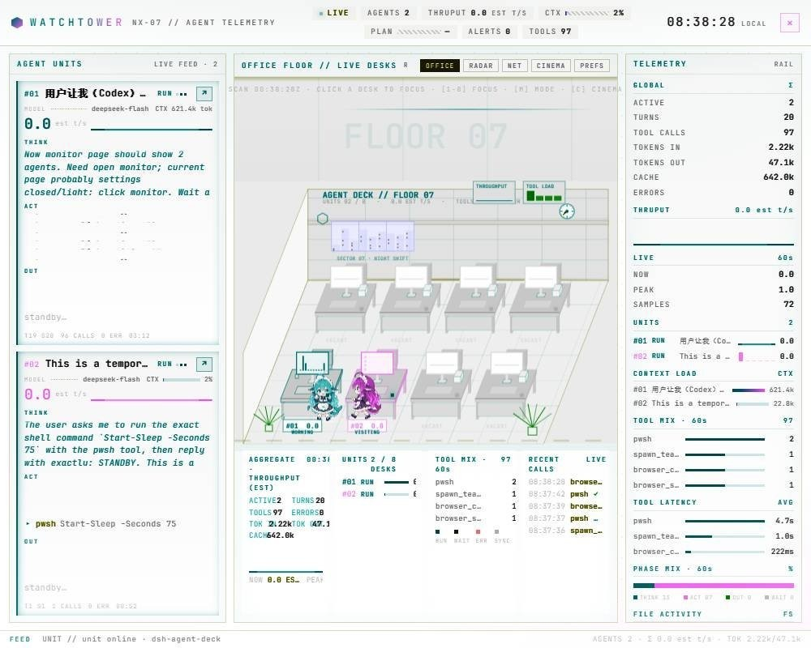
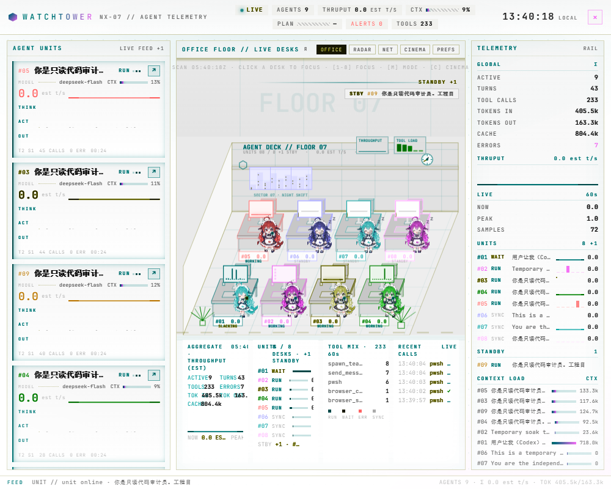
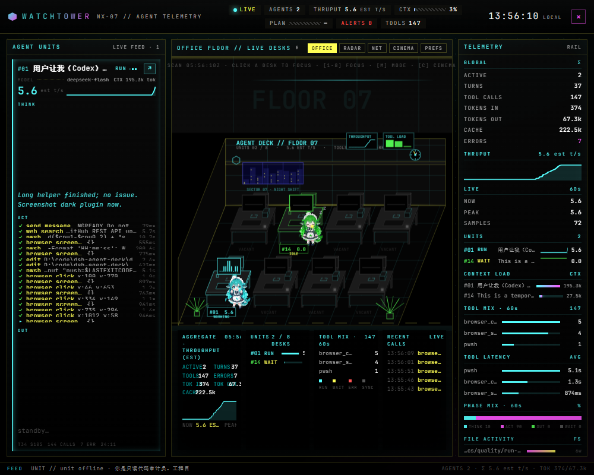
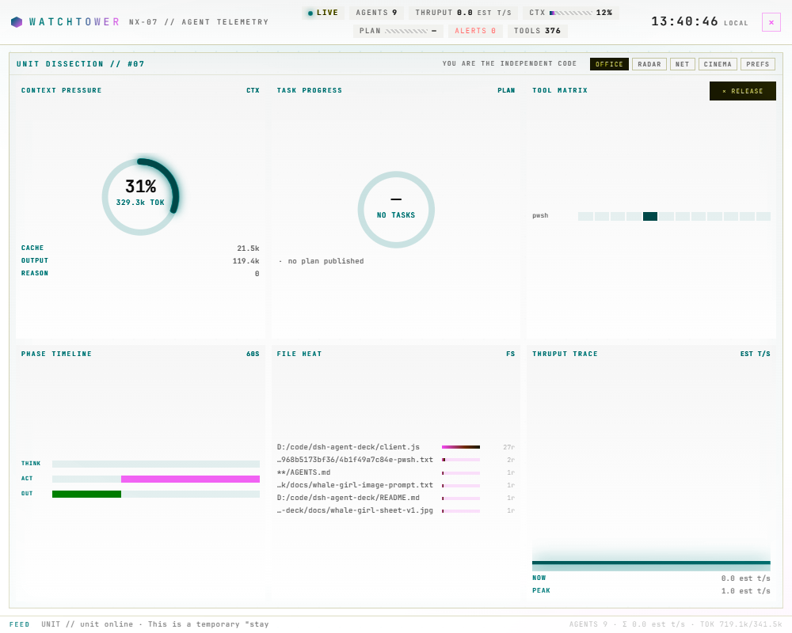
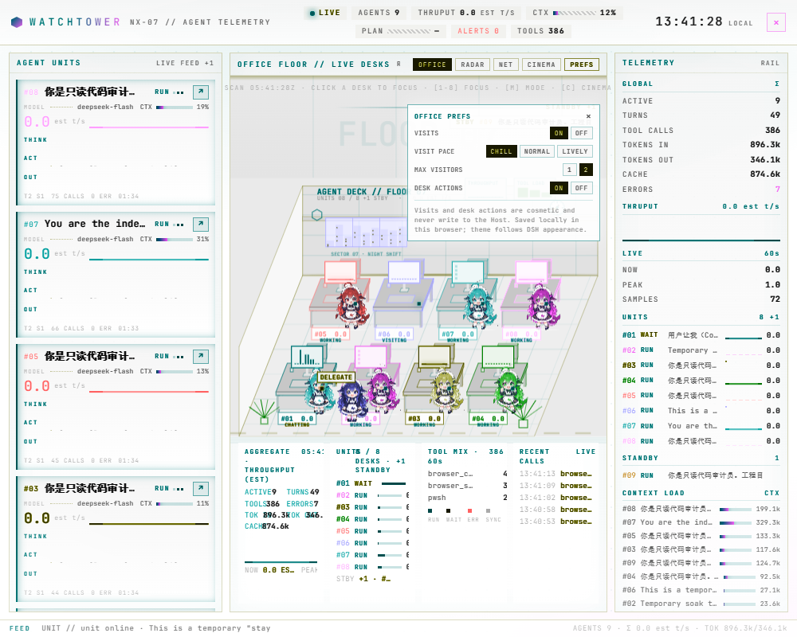
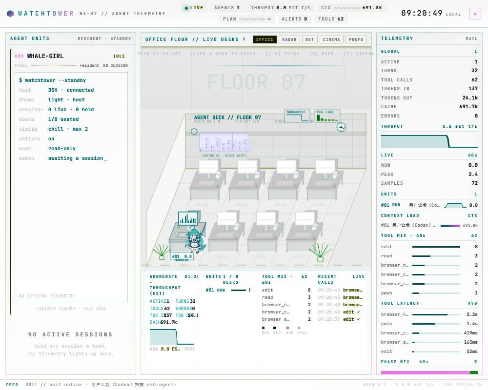

# Visual baselines

These are **manual** visual baselines for the plugin panel. They are not yet
automated in CI: the repository has no Playwright/browser dependency and the
current test suite only validates the bundle, not rendered pixels.

All images were captured at 1280×800, DPR 100%, then cropped to the plugin
panel (1000×800). Replace a baseline only when the visual change is intentional,
and mention it in the changelog.

| Baseline | Scenario | What to inspect |
|---|---|---|
|  | Office, light theme, two active units | desk geometry, sprites, seat labels, light palette |
|  | Office, light theme, two active units | 8 seats filled, STANDBY tray, LIVE FEED +N |
|  | Office, dark theme, two active units | CGA palette, glow, contrast, no sprite fringe |
|  | ANALYZE focus mode, light theme | six widgets, release button, hidden sidebars |
|  | PREFS open, light theme | segmented controls, readable contrast |
|  | Resident/standby card, light theme | terminal lines, no duplicated whale-girl image |

## Manual comparison

1. Open the plugin at `1280×800` with DPR 100%.
2. Match the scenario (theme, PREFS/focus state, active unit count).
3. Crop the plugin panel from `x=280` to the right edge.
4. Compare against the matching file above; use a pixel-diff tool if needed.

Known gaps for this round:

- FPS / light-theme filter cost is still measured manually, not in CI.
- Seat reclamation after the 3-minute idle hold is being observed separately
  (see `run-2026-11-06.md`).
- Dark-theme and reduced-motion baselines still come from the previous UI capture.
